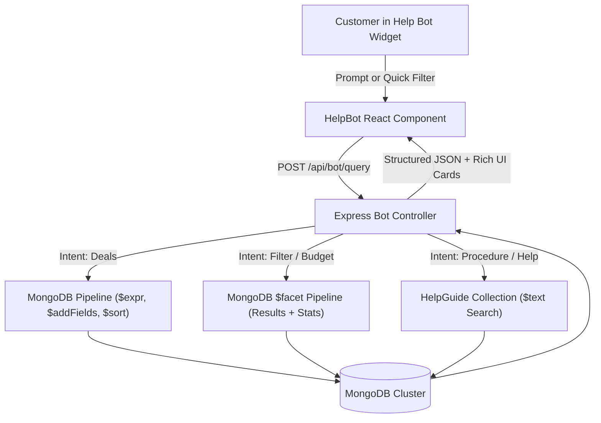

# 🚀 ShopVerse NoSQL Architecture & Senior Developer Guide

This document details the **NoSQL (MongoDB) architectural patterns, aggregation pipelines, schema strategies, and indexing techniques** implemented in this e-commerce project. It is structured to help you present and defend this system in a Senior Developer practical evaluation or technical interview.

---

## 1. Executive Summary & Database Justification

### Why NoSQL (MongoDB) over Relational (SQL/RDBMS) for E-Commerce?

1. **Polymorphic Product Taxonomies**:
   - Products vary widely in attributes (e.g., Electronics have *voltage*, *RAM*, *warranty*; Apparel has *sizes*, *colors*, *fabric*).
   - In relational databases, this requires the anti-pattern *Entity-Attribute-Value (EAV)* with 5+ table joins, which degrades performance.
   - In MongoDB, flexible BSON schemas handle polymorphic products natively with zero join overhead.

2. **Access Pattern Alignment (Read-Heavy 95:5 Ratio)**:
   - E-commerce catalog traffic is over 95% reads.
   - Document databases allow fetching an entire product document (with images, variants, badge, rating) in a **single sub-millisecond I/O operation** without foreign key joins across the 49 active catalog documents spanning 7 store departments.

3. **Horizontal Scalability (Sharding)**:
   - Sharding can partition data across clusters using shard keys like `category` (for catalog browsing) or `userId` (for orders and sessions).

4. **CAP Theorem Position**:
   - MongoDB acts primarily as a **CP system** (Consistency + Partition tolerance) under standard primary-replica configurations with `majority` write concern, guaranteeing data accuracy during inventory updates.

---

## 2. Advanced NoSQL Schema Design Patterns Implemented

### A. Extended Reference Pattern (Order Snapshots)
* **Location**: `server/models/Order.js`
* **Problem**: In relational models, order items point to a `product_id`. If a vendor changes a product's price from \$50 to \$70 next month, past order totals would falsely change or require messy audit tables.
* **Solution**: The `items` array inside `Order` stores a **point-in-time snapshot** of the product (`title`, `price`, `image`, `color`, `size`).
* **Benefit**:
  - Zero `$lookup` / JOIN operations required when fetching user order history.
  - Historical financial immutability is guaranteed.

### B. Dynamic Aggregation Pipeline for Deals & Promotions
* **Location**: `server/controllers/botController.js` & `server/controllers/productController.js`
* **Pipeline Used**:
  ```javascript
  [
    // 1. Filter products where oldPrice exists and is greater than current price
    {
      $match: {
        oldPrice: { $ne: null, $gt: 0 },
        $expr: { $gt: ["$oldPrice", "$price"] }
      }
    },
    // 2. Dynamically calculate discount percentage and exact savings
    {
      $addFields: {
        discountPercent: {
          $round: [
            {
              $multiply: [
                { $divide: [{ $subtract: ["$oldPrice", "$price"] }, "$oldPrice"] },
                100
              ]
            },
            0
          ]
        },
        savingsAmount: {
          $round: [{ $subtract: ["$oldPrice", "$price"] }, 2]
        }
      }
    },
    // 3. Sort by deepest discount first, then rating
    { $sort: { discountPercent: -1, rating: -1 } },
    { $limit: 4 }
  ]
  ```
* **Why this is Senior-grade**: The discount math and sorting happen directly in the database engine using vector operations, avoiding pulling large datasets into Node.js memory.

### C. Faceted Aggregation Search (`$facet`)
* **Location**: `server/controllers/botController.js` (`handleBotQuery`)
* **Purpose**: In a single database round-trip, MongoDB executes multiple parallel pipelines:
  1. **Matching Products**: Top-rated recommendations within the user's budget.
  2. **Summary Statistics**: Computes `$avg`, `$min`, `$max` price, and total matched count using `$group`.

---

## 3. Intelligent Shopping & Procedure Help Bot

The Help Bot (`src/components/bot/HelpBot.jsx` and `server/controllers/botController.js`) serves as a practical demonstration of MongoDB's real-time capabilities:



### Capabilities Demonstrated by the Bot:
1. **Live Deal Finder**: Employs live aggregation to extract top deals sorted by percentage savings.
2. **Budget Product Filtering**: Automatically extracts budget limits (e.g., *"items under 50"*) and applies compound constraints (`price: { $lte: 50 }`).
3. **Step-by-Step Procedural Guidance**: Queries the `HelpGuide` MongoDB collection to present verified interactive workflows:
   - **Checkout Procedure**: 5-step visual guide from cart to order placement.
   - **Order Tracking Procedure**: Live instructions on tracking parcel status.
   - **Return & Refund Policy**: Transparent 14-day turnaround policy.
   - **Payment Security & Methods**: Card encryption, UPI, and Cash on Delivery details.
4. **Google Gemini RAG Grounding**:
   - Converts arbitrary customer prompts into structured MongoDB query parameters.
   - Synthesizes personalized natural language replies grounded strictly in returned BSON documents, preventing AI hallucinations.
   - Incorporates a fault-tolerant hybrid architecture: seamlessly falls back to native MongoDB regex and pipelines if an API key is omitted.

---

## 4. Indexing Strategy & Query Optimization

### 1. Compound Indexes & The ESR Rule
* **Rule**: **E**quality filters first $\rightarrow$ **S**ort fields second $\rightarrow$ **R**ange filters last.
* **Example in Catalog**:
  ```javascript
  productSchema.index({ category: 1, createdAt: -1, price: 1 })
  ```
  - Equality: `category = 'electronics'`
  - Sort: `sort({ createdAt: -1 })`
  - Range: `price: { $gte: 20, $lte: 100 }`
  - Result: Eliminates in-memory sorting (`SORT` stage) and performs index scans (`IXSCAN`) instead of collection scans (`COLLSCAN`).

### 2. Compound Full-Text Search Index
* **Location**: `server/models/Product.js` and `server/models/HelpGuide.js`
  ```javascript
  productSchema.index({ title: 'text', brand: 'text', description: 'text', category: 'text' })
  helpGuideSchema.index({ title: 'text', summary: 'text', tags: 'text' })
  ```
  - Enables stemming, stop-word filtering, and relevance score calculation via `{ score: { $meta: "textScore" } }`.

---

## 5. Multi-Document ACID Transactions (Checkout Architecture)

In distributed NoSQL systems, inventory overselling during high-concurrency checkouts must be handled atomically:

```javascript
// Production-grade MongoDB Transaction Workflow:
const session = await mongoose.startSession()
session.startTransaction()

try {
  // 1. Atomically verify and decrement product inventory
  for (const item of items) {
    const updatedProduct = await Product.findOneAndUpdate(
      { id: item.product, stock: { $gte: item.qty } },
      { $inc: { stock: -item.qty } },
      { session, new: true }
    )

    if (!updatedProduct) {
      throw new Error(`Insufficient stock for product ID: ${item.product}`)
    }
  }

  // 2. Create the immutable order document
  const [order] = await Order.create([orderPayload], { session })

  // 3. Commit the transaction
  await session.commitTransaction()
} catch (err) {
  // 4. Abort and rollback all operations if any step fails
  await session.abortTransaction()
  throw err
} finally {
  session.endSession()
}
```

---

## 6. Key Interview Questions to Expect & How to Answer

### Q1: "Why not use PostgreSQL with JSONB instead of MongoDB?"
> **Answer**: While PostgreSQL has JSONB, MongoDB is fundamentally designed for horizontal scaling (native sharding, auto-balancing replica sets, flexible write concerns) and treats BSON documents as first-class citizens. MongoDB's Aggregation Framework provides expressive data processing pipelines (`$facet`, `$bucket`, `$unwind`) that are easier to maintain and optimize than complex SQL JSON operators.

### Q2: "How do you avoid the 16MB document size limit in MongoDB?"
> **Answer**: We avoid unbounded arrays. For instance, in our review system, we use the **Subset Pattern**: we embed only the 5 most recent reviews in the `Product` document for sub-millisecond product page loads, while storing the complete historical reviews in a separate `reviews` collection referenced by `productId`.

### Q3: "How do you prevent race conditions when two users buy the last item at the exact same time?"
> **Answer**: We use **atomic conditional updates** (`$inc` with `{ stock: { $gte: qty } }`) wrapped within a **MongoDB Client Session with multi-document ACID transactions**. If the condition fails, `findOneAndUpdate` returns `null`, the transaction aborts, and the second user receives an immediate out-of-stock notification without any data corruption.

