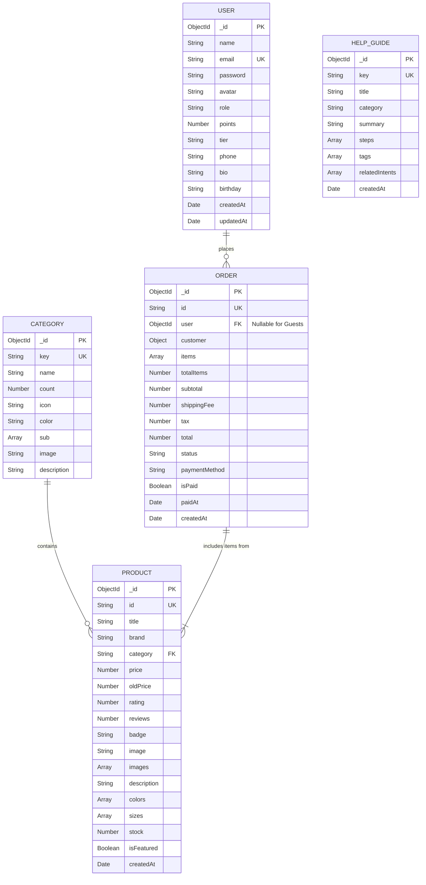
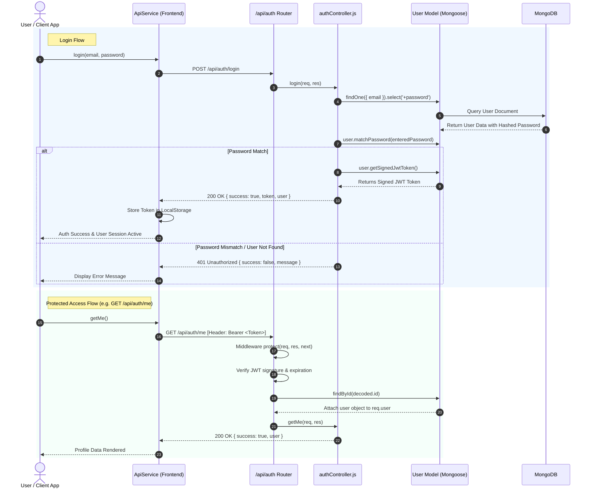
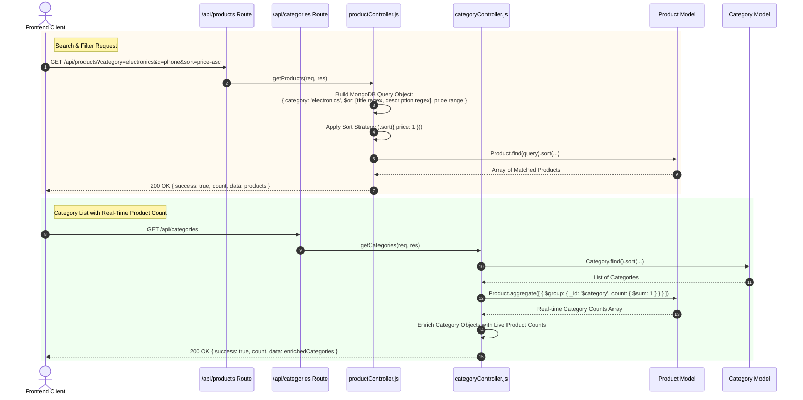
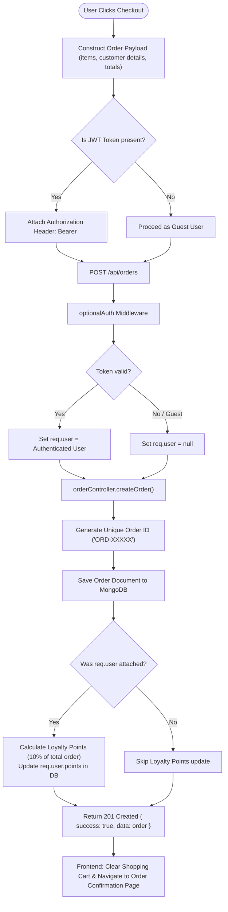
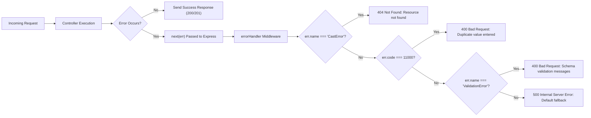
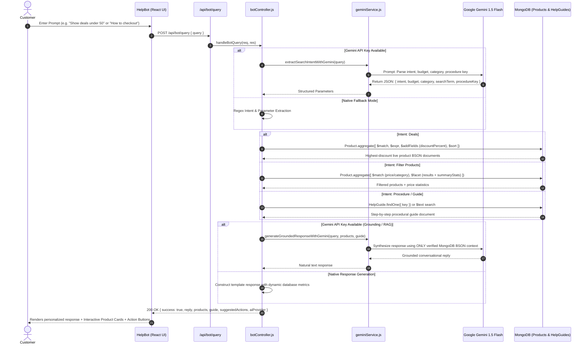

# ShopVerse — Visual Architecture & Data Flow Diagrams

This document presents interactive Mermaid diagrams illustrating each component, database relationship, and data flow pipeline across the ShopVerse application.

---

## 1. High-Level System Architecture Diagram

```mermaid
graph TD
    subgraph Client ["Frontend (React + Vite)"]
        UI["React Pages & UI Components"]
        Ctx["React Context / State (AuthContext, CartContext)"]
        API["ApiService (src/services/api.js)"]
        Storage[("Browser LocalStorage (JWT Token)")]
    end

    subgraph Server ["Backend (Node.js + Express)"]
        ServerEntry["Express App (server/index.js)"]
        MW_Global["Global Middleware (Cors, Morgan, BodyParser)"]
        MW_Auth["Auth Middleware (protect / optionalAuth)"]
        MW_Err["ErrorHandler Middleware (errorHandler.js)"]
        
        subgraph Routers ["API Route Handlers"]
            R_Auth["/api/auth"]
            R_Prod["/api/products"]
            R_Cat["/api/categories"]
            R_Ord["/api/orders"]
            R_Bot["/api/bot"]
        end

        subgraph Controllers ["Business Logic Controllers"]
            C_Auth["authController.js"]
            C_Prod["productController.js"]
            C_Cat["categoryController.js"]
            C_Ord["orderController.js"]
            C_Bot["botController.js"]
        end

        subgraph Services ["External & AI Services"]
            S_Gemini["geminiService.js (Gemini 1.5 Flash RAG)"]
        end

        subgraph Models ["Mongoose Models"]
            M_User["User.js"]
            M_Prod["Product.js"]
            M_Cat["Category.js"]
            M_Ord["Order.js"]
            M_HelpGuide["HelpGuide.js"]
        end
    end

    subgraph ExternalAI ["External AI Services"]
        GeminiAPI[("Google Gemini 1.5 Flash API")]
    end

    subgraph Database ["Database"]
        MongoDB[("MongoDB Database ('shopverse')")]
    end

    %% Client Internal Flow
    UI -->|Triggers Actions / Chat| Ctx
    Ctx -->|Calls| API
    API <-->|Reads / Writes Token| Storage

    %% HTTP Connection
    API -->|HTTP Requests with Bearer Token| ServerEntry
    ServerEntry --> MW_Global
    MW_Global --> Routers

    %% Route to Middleware & Controllers
    R_Auth -->|protect/getMe, updateProfile| MW_Auth
    R_Ord -->|optionalAuth/createOrder| MW_Auth
    MW_Auth --> C_Auth
    MW_Auth --> C_Ord

    R_Auth --> C_Auth
    R_Prod --> C_Prod
    R_Cat --> C_Cat
    R_Ord --> C_Ord
    R_Bot --> C_Bot

    %% Controllers to Services & Models
    C_Auth -->|Bcrypt, JWT, Queries| M_User
    C_Prod -->|Search, Filter, Sort| M_Prod
    C_Cat -->|Aggregate Count| M_Cat
    C_Cat -->|Aggregation Query| M_Prod
    C_Ord -->|Create Order, Loyalty Points| M_Ord
    C_Ord -->|Update User Points| M_User
    C_Bot -->|Aggregation Pipelines / $facet| M_Prod
    C_Bot -->|$text Search / Guides| M_HelpGuide
    C_Bot <-->|RAG Grounding & Intent| S_Gemini
    S_Gemini <-->|REST API Fetch| GeminiAPI

    %% Models to Database
    M_User <--> MongoDB
    M_Prod <--> MongoDB
    M_Cat <--> MongoDB
    M_Ord <--> MongoDB
    M_HelpGuide <--> MongoDB

    %% Error Handling
    Controllers -.->|next(err)| MW_Err
```

---

## 2. Database Entity-Relationship Diagram (ERD)



---

## 3. User Authentication & JWT Flow



---

## 4. Product Browsing, Filtering & Aggregation Data Flow



---

## 5. Order Creation & Loyalty Points Checkout Flow



---

## 6. Centralized Error Handling Pipeline



---

## 7. AI Assistant & Google Gemini RAG / Aggregation Flow


