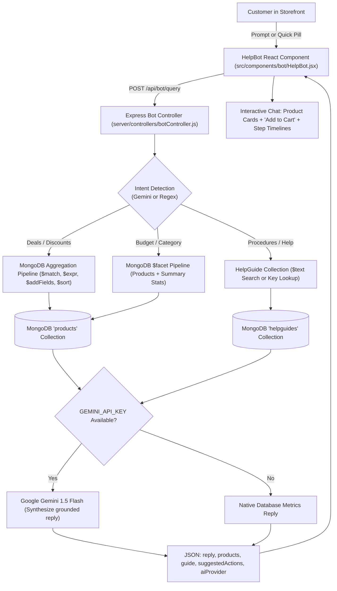

# 🤖 Feature: ShopVerse AI Shopping & Procedure Assistant (NoSQL + Gemini RAG)

This document details the newly added **AI Shopping & Procedure Assistant (`Ask ShopVerse`)** and the **Catalog Expansion (49 Products across 7 Departments)**.

---

## 🌟 Feature Overview

The ShopVerse Assistant is an intelligent, reactive shopping and procedural help bot embedded directly into the storefront. Unlike traditional chatbots with hardcoded static replies, this assistant is powered directly by **MongoDB Aggregation Pipelines**, a **NoSQL Knowledge Base (`HelpGuide`)**, and an optional **Google Gemini 1.5 Flash Grounded RAG** pipeline.

### Core Capabilities
1. **Live Deals Discovery**: Evaluates real-time discounts using MongoDB `$expr` and `$addFields`, calculating percentage markdown and surfacing clickable product deal cards inside the chat.
2. **Budget & Department Filtering**: Automatically parses price constraints (e.g. *"under 50"*, *"less than 50 percent"*, *"electronics below 2000"*) and executes `$facet` aggregations returning top recommendations alongside price summary metrics.
3. **Step-by-Step Store Procedures**: Directly answers operational questions (How to checkout, how to track packages, return/refund policies, payment methods, and loyalty reward tiers) through verified multi-step visual workflows.
4. **Grounded AI Synthesis (RAG)**: Uses Google Gemini 1.5 Flash to synthesize personalized conversational replies grounded strictly in verified MongoDB documents, avoiding hallucinations.
5. **Theme-Integrated UI**: Designed with ShopVerse's signature brand gradients (`brand-600`, `fuchsia-600`, `purple-600`), animated status pulse indicator, and clean modal layering.

---

## 📊 Technical Comparison: Junior vs Senior Implementation

| Feature | Standard (Junior/Mid) Approach | Senior Developer NoSQL Implementation in ShopVerse |
| :--- | :--- | :--- |
| **Product Filtering** | Client-side `.filter()` on static arrays. | **MongoDB `$facet` Aggregation Pipeline**: computes matching items and catalog price metrics in a single round-trip. |
| **Deals Discovery** | Static API call or hardcoded deal tags. | **MongoDB `$expr` Pipeline**: calculates $\frac{\text{oldPrice} - \text{price}}{\text{oldPrice}} \times 100$ and sorts by deepest savings. |
| **Procedures & Guides** | Hardcoded text inside React state. | **NoSQL Knowledge Base Collection (`HelpGuide`)**: indexed with compound `$text` search and structured step arrays. |
| **AI Integration** | Raw user text piped directly to LLM. | **Grounded RAG Flow**: Gemini parses intent, queries live MongoDB collections, and synthesizes answers based strictly on real BSON documents. |
| **Fault Tolerance** | App crashes if external AI API fails. | **Hybrid Architecture**: Automatically falls back to native database regex and aggregation pipelines if `GEMINI_API_KEY` is omitted or unreachable. |

---

## 🏗️ Architecture & Data Flow



---

## 📦 Catalog Expansion: 49 Live MongoDB Products

The database has been seeded with 49 products spanning all 7 store categories:

1. **Electronics (8 items)**: ANC Headphones, OLED Smartwatches, Wireless Earbuds, RGB Mechanical Keyboards, 4K Mirrorless Cameras, Waterproof Speakers, M2 Ultralight Laptops, 1080p Cinema Projectors.
2. **Fashion (8 items)**: Vintage Denim Jackets, Linen Resort Shirts, Leather City Backpacks, Canvas Low-Tops, Titanium Aviators, Italian Chronographs, Heavyweight Fleece Hoodies, Vegan Leather Totes.
3. **Home & Living (6 items)**: Ceramic Barista Sets, Aroma Diffusers, Velvet Lounge Armchairs, Bamboo 400TC Sheets, Dimmable Desk Lamps, Damascus Chef Knives.
4. **Beauty & Care (6 items)**: Botanical Brightening Oils, Rose Quartz Gua Sha Sets, Luxury Eau De Parfum, Hyaluronic Acid Serums, Argan Hair Repair Masks, Mineral Sunscreens SPF 50+.
5. **Sports & Outdoors (5 items)**: Natural Rubber Yoga Mats, Vacuum Insulated Flasks, Cast Iron Adjustable Dumbbells, 45L Mountain Backpacks, Resistance Band Kits.
6. **Grocery & Gourmet (4 items)**: Single-Origin Arabica Beans, Cold-Pressed Greek Olive Oil, Raw Wildflower Honey with Comb, Belgian Dark Chocolate Truffles.
7. **Toys & Kids (3 items)**: STEM Programmable Robotics Kits, Magnetic 3D Building Tiles, Giant Plush Teddy Bears.

---

## 🧪 Verification & How to Test

1. Launch application:
   ```bash
   npm run dev:all
   ```
2. In the browser (`http://localhost:5173`), click the **"Ask ShopVerse"** floating orb on the bottom-right.
3. Try these prompts:
   - **`less than 50 percent`** (or click the **`🎯 < 50% Off`** pill): Tests the live MongoDB discount percentage pipeline.
   - **`headphones under 50`**: Tests the budget-matching `$facet` pipeline.
   - **`how to checkout`**: Tests the `HelpGuide` procedural workflow retrieval.
   - **`return and refund policy`**: Tests the store policy guide.
   - Click **"Add"** on any product card in the chat to immediately add it to your cart.
